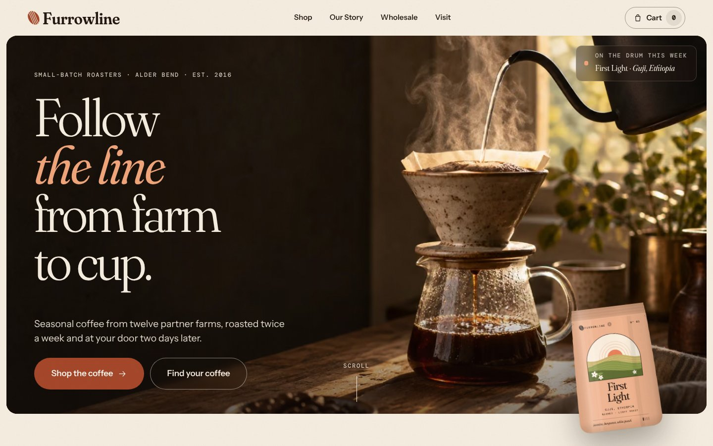
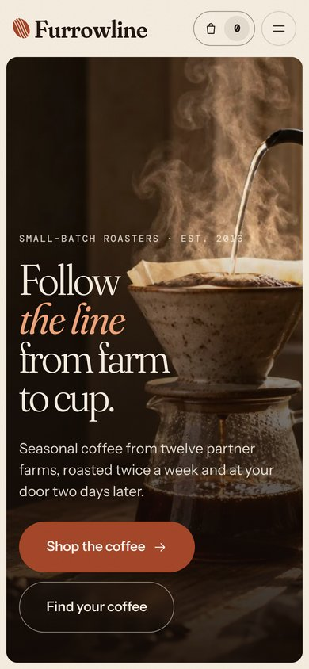

# Furrowline Coffee Roasters

A brand identity and storefront for a small-batch coffee roaster, built with Next.js.

**Concept project.** The brand is fictional: Furrowline is an invented roaster, designed and built end to end as a
portfolio piece. It is not a real business, nothing on the site takes payment, and the people, address and contact
details on it are made up.

**Try it:** [furrowline-coffee.vercel.app](https://furrowline-coffee.vercel.app)

**Write-up:** [michaelshadpour.com/work/furrowline-coffee-roasters](https://michaelshadpour.com/work/furrowline-coffee-roasters)





The identity grows from one idea, *follow the line*: the furrow a plow draws, the contour of a coffee hill, the
rows raked across a drying patio, and the line from farm to cup. See [DESIGN.md](DESIGN.md) for the design system.

## Features

- **Brand**: outlined SVG logo in four lockups plus the furrowed-bean mark, palette with contrast-checked pairs,
  Fraunces / Instrument Sans / DM Mono pairing, packaging illustrations for every coffee (each with its own
  landscape motif), a one-page brand guide (`/brand-guide`) and a brand board with mockups (`/brand-board`).
- **Home**: photo hero with a mask reveal, a pinned horizontal showcase of the four signature coffees (a snap
  carousel on touch), a scroll-drawn origin route with counters, a velocity-reactive marquee, a three-question
  "Find your coffee" quiz, and a newsletter signup.
- **Shop**: a grid of 12 products (7 coffees, 3 pieces of brewing gear, 2 merch items) with filters (type: coffee,
  gear or merch; roast; country, style and process), sorting, animated filtering that stays in the URL, and quick
  add; product pages with grind and size options that change the price, and subscribe and save (every 2, 3 or 4
  weeks, 10% off).
- **Cart drawer**: quantities, remove, subscription savings, free-shipping progress, saved in `localStorage` across
  pages and reloads, with a fly-to-cart animation. Checkout explains that this concept takes no payment.
- **Our Story** with sticky storytelling, a validated **Wholesale** inquiry form, **Visit** with live opening hours
  and an illustrated map, and a designed 404.
- **Motion**: Lenis smooth scrolling synced to GSAP ScrollTrigger, page transitions with the View Transitions API,
  magnetic buttons, underline and fill sweeps, a cursor "View" bubble on fine pointers. All of it respects
  `prefers-reduced-motion`, and none of it delays first paint.
- **Quality**: TypeScript strict, static generation for every page, unit tests for the real logic (cart totals,
  pricing by size, grind and subscription, quiz scoring, shop filters and sorting, product options and URL state,
  opening hours across time zones and DST, the wholesale form, palette contrast and the sign homography), an
  automated QA script (overflow, console errors, failed requests, axe), and performance rules written to keep
  Lighthouse at 90 or higher (section 10 of [DESIGN.md](DESIGN.md)).

## Stack

Next.js 16 (App Router, static generation: every route is prerendered at build time and served by `next start` or
any Next.js host) · React 19 · TypeScript (strict) · Tailwind CSS 4 · GSAP 3 (ScrollTrigger) + Lenis · zod (mini) ·
Vitest · Playwright + axe-core.

## Run it

Needs Node.js 22.12 or newer.

```bash
npm install
npm run dev          # http://localhost:3000
```

Production build:

```bash
npm run build
npm run start        # serves the production build on http://localhost:3000
```

| Script | What it does |
|---|---|
| `npm run dev` | Development server. |
| `npm run build`, then `npm run start` | Production build, then serve it. |
| `npm run typecheck` | `tsc --noEmit` (strict). |
| `npm test` | Vitest unit tests (`src/**/*.test.ts`): 164 test cases in 10 files. |
| `npm run test:watch` | The same tests in watch mode. |
| `npm run qa -- --base http://127.0.0.1:3000` | Against a running server, visits pages at 390, 768, 1280 and 1440 px and checks each visit for horizontal overflow, console and page errors, failed requests and axe violations (serious or critical). By default it covers the seven main pages, 5 of the 12 product pages and a missing URL for the 404. Screenshots go to `.qa/shots/`, the report to `.qa/qa-report.json`. Options: `--routes /,/shop`, `--widths 390,1440`, `--no-shots`. |
| `npm run brand` | Re-exports the identity from the components: `brand/*.svg`, `brand/palette.json`, favicon set, app icons, Open Graph image, contour textures and pre-rendered packaging art (it also clears the `next/image` cache so the new art is served). Run it after changing the logo, packaging or textures, then rebuild. |

`npm run qa` and `npm run brand` drive Chromium through Playwright. Install the browser once with
`npx playwright install chromium`.

A GitHub Actions workflow (`.github/workflows/ci.yml`) runs the type check, the unit tests and the production build
on pushes to `main` and on pull requests.

## Layout

```
src/
  app/                  routes (App Router), template.tsx (page transitions), globals.css (design tokens)
  components/
    brand/              Logo, Mark, Stamp (outlined paths in logo-data.ts / mark-data.ts)
    brand-guide/        /brand-guide: the 1280 × 769 identity sheet and its notes
    brand-board/        /brand-board: cup, pouch, card and fascia mockups (homography for the sign)
    cart/               CartProvider (context + localStorage), CartDrawer, CartButton, fly-to-cart
    home/               Home page sections and their scroll scenes
    illustration/       Contour/furrow primitives, <Texture>
    layout/             Header, MobileMenu, Footer, PageHeader, SkipLink, BackToTop
    motion/             MotionProvider (Lenis), InteractionLayer (reveals, parallax, magnetic, cursor), Scene
    not-found/          The designed 404 field illustration
    packaging/          Coffee bag, label motifs, gear and merch art (SVG)
    pdp/                Product page: sticky stage, configurator, buy bar, notes, origin, brew guide, FAQ
    photo/              <Photo> slot system and illustrated fallbacks
    product/            ProductCard, ProductImage, AddToCartButton, QuickAdd
    shop/               Shop grid, filters (toolbar, popovers, mobile drawer), animated filtering, editorial tiles
    story/              Our Story: opening, founder, sticky farm-to-cup chapters, farms, values, timeline
    ui/                 Button, fields, choices, badges, drawer, meters, empty state, typography, icons
    visit/              Visit: hours with an open-now indicator, illustrated town map, menu, cupping
    wholesale/          Wholesale: offer, steps scene, pricing, voices, validated inquiry form
  content/              Typed data: products, photos, origins, site, textures, plus copy for pdp, story,
                        visit and wholesale
  fonts/                Self-hosted font subsets (woff2)
  lib/                  Pure, unit-tested logic (cart, pricing, quiz, forms, shop, product-options, hours,
                        wholesale), geometry, fonts, motion helpers
brand/                  The identity's own files: the logo in four versions and the mark as SVG, and
                        palette.json. npm run brand writes them (the SVGs from the components in
                        src/components/brand), and the brand guide page reads palette.json
public/photos           Photography (see below)
public/packaging        Pre-rendered product art (npm run brand)
public/textures         Contour textures and grain (npm run brand)
public/icons            App icons (npm run brand)
public/video            Empty: the place for the optional hero video (see below)
scripts/                qa.ts (npm run qa) and build-brand.ts (npm run brand)
docs/                   The two screenshots in this README
DESIGN.md               The design system
```

Adding `?showcase=linear` to any page turns scroll scenes and reveals off and stacks the pinned sections, so a
full-page screenshot shows every section. Some code comments mention showcase captures made this way. The scripts
that took them, and the `showcase/` folder they wrote to, are not part of this repository.

## Adding photography

Every photo on the site has a named **slot** (`src/content/photos.ts`). To use a photo, save it as
`public/photos/<slot>.webp` (or `.jpg`, `.jpeg`, `.png`, `.avif`) and rebuild; `<Photo slot="...">` picks it up at
build time and serves it through `next/image`. If a slot has no file, an illustrated SVG fallback in the brand
palette is shown instead, so the site never shows a broken image.

| Slot | Shape | Where it appears |
|---|---|---|
| `hero-pour` | 3:2 | Home hero (keep the left third dark for the headline), gear brew steps |
| `roastery` | 3:2 | Home story and route map, Our Story opening, Field Day product page |
| `founder` | 2:3 | Home manifesto and story, Our Story founder |
| `beans-roasting` | 1:1 | Home manifesto, Deep Field panel, blend product pages, Our Story roast chapter |
| `origin-ethiopia` / `origin-colombia` / `origin-guatemala` | 3:2 | Showcase panels, product pages, route map, Our Story farms |
| `cherries` | 1:1 | Home manifesto, decaf product page, Our Story farm chapter |
| `cupping` | 3:2 | Our Story cup chapter, Harvest Lantern product page, Wholesale steps, Visit cupping |
| `cafe-interior` | 3:2 | Visit hero |
| `storefront` | 2:3 | Visit address, Our Story closing, brand board fascia, tote product page |
| `espresso-bar` | 3:2 | Wholesale hero, Deep Field product page |
| `brew-gear` | 3:2 | Shop brew banner, brew guides, gear product pages |
| `latte` | 1:1 | Newsletter, Our Story cup chapter, mug product page |
| `hands-sorting` | 2:3 | Home story, Our Story farm chapter |

Each slot lists its recommended size, focal point (`focus`, used as the default crop), alt text and a shot list
entry that says what the photo should show. Recommended sizes: 2400 × 1600 (3:2), 1600 × 2400 (2:3),
2000 × 2000 (1:1); WebP or high-quality JPEG.

**Optional hero video**: add `public/video/hero-loop.mp4` (a 6 to 10 s loop with no visible cut, 3:2, H.264, no
audio, under 4 MB) and rebuild. It plays muted and looped over the hero photo once the page is idle, never for
visitors who prefer reduced motion or have Save-Data on, and never affects first paint (the photo stays the LCP
element). No clip is included.

## Deploy

The live copy is hosted on Vercel. `vercel.json` sets the Next.js preset, an `X-Robots-Tag: noindex, nofollow`
header on every path, and immutable caching for static assets. The other response headers are set in
`next.config.ts`. The sitemap, `robots.txt` and canonical URLs use a placeholder domain,
`https://furrowline.example.com` (`SITE.url` in `src/content/site.ts`).

## Credits and license

- Design and build: [Michael Shadpour](https://michaelshadpour.com).
- Photography: original images made for this concept (no stock photos).
- Logo, mark, packaging illustrations, product art, patterns, map and every other graphic: original SVG/CSS made
  for this project.
- Fonts: Fraunces, Instrument Sans and DM Mono from Google Fonts, each under the
  [SIL Open Font License 1.1](https://scripts.sil.org/OFL), self-hosted in `src/fonts` as subsets from the
  `@fontsource` packages.
- The code is under the MIT license. See [LICENSE](LICENSE).
